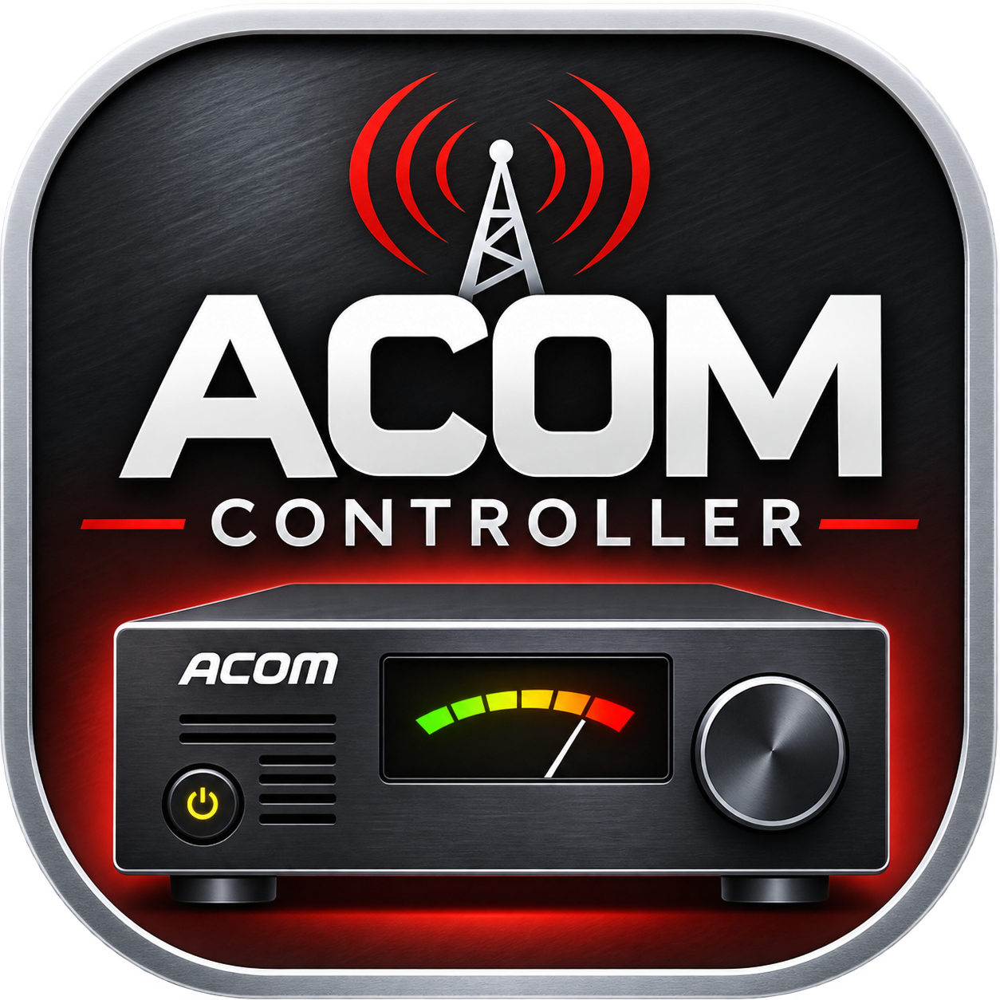

<p align="center"></p>

<h1 align="center">ACOM Controller</h1>

A modern, single-executable Windows controller for ACOM solid-state amplifiers
(600S, 700S, 500S, 1200S, 1400S, 2020S), written in Rust.

It talks to the amplifier over its RS-232 interface using the protocol described in
`doc/ACOM_RS_232_Serial_Protocol_Description_for_Solid-State_Amplifiers_GB_01_2026.pdf`.

> Status: early development. Runs in built-in demo mode and has been exercised on an ACOM 1200S (connect, telemetry, remote power on/off). Other models are untested. See [Roadmap](#roadmap).

## Goals

- **One file to ship** – a statically linked `acom-controller.exe`, no installer, no runtime.
- **Live dashboard** – forward/reflected/drive power, SWR, PA current, voltages, temperatures,
  fan speed, active LPF, with history plots and peak hold.
- **Full control** – standby/operate, TX inhibit, band selection (current band highlighted), fault clearing,
  alarm log; antenna/segment/ATU controls appear only when the amplifier has an ATU/ASEL.
- **Remote power on/off** – one header button that switches between *Power on* and *Power off*. Power-on drives
  the RS-232 DTR/RTS control lines (default DTR+RTS, 1000 ms; configurable in Settings). The app keeps
  polling while the amplifier is off and picks it up as soon as it boots.
- **Radio integration** – follow the transceiver frequency from logging software or rigctld and
  switch the amplifier band automatically.
- **Remote operation** – share the amplifier's serial port over TCP and control it from another PC.
- **Demo mode** – built-in amplifier simulator, so the UI can be explored without hardware.

## Build

Requires a recent stable Rust toolchain with the MSVC target.

```powershell
cargo test              # protocol unit tests
cargo run               # debug build
cargo build --release   # target\release\acom-controller.exe
```

## Layout

| Path | Purpose |
| --- | --- |
| `src/protocol/` | Framing, message decoding, command builders, alarm catalogue (no I/O) |
| `src/` (other) | Config, serial/TCP link, simulator, radio integrations, UI |
| `doc/` | Manufacturer protocol documentation |

## Safety

This software can switch an RF power amplifier between operating states. Always verify behaviour
with a dummy load first. The authors accept no responsibility for equipment damage.

## Roadmap

- [x] Protocol layer with tests
- [x] Serial link + amplifier simulator
- [x] Dashboard UI
- [x] Radio integrations (N1MM+ UDP, rigctld, shared-memory loggers) – untested with real loggers
- [x] Remote (TCP) mode – untested
- [x] Remote power on/off verified on ACOM 1200S
- [ ] Wider hardware validation (other models, ATU/ASEL, units and severity assumptions)
- [ ] Tray icon, exe icon, sound alerts, hard-fault viewer, settings editor
