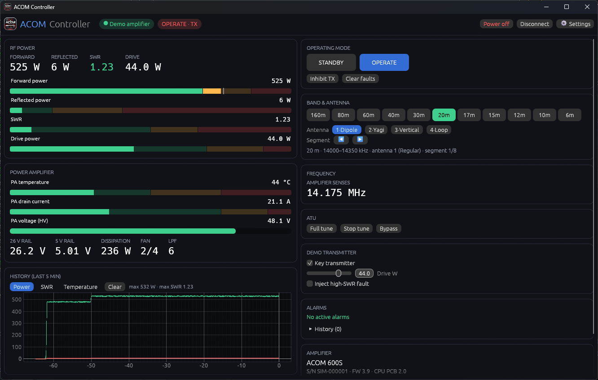
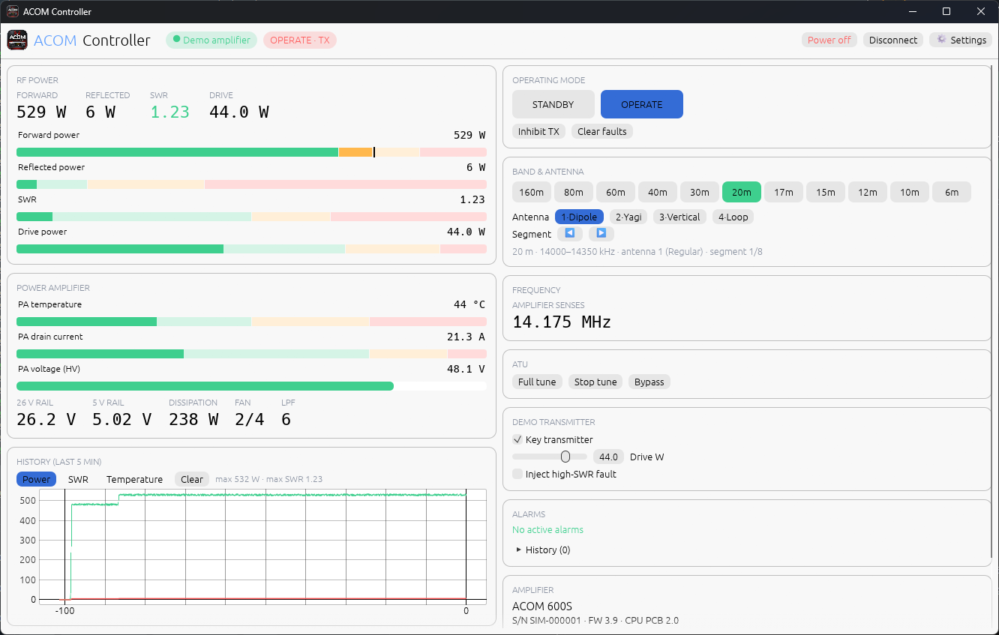
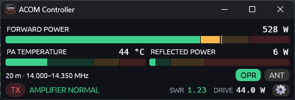
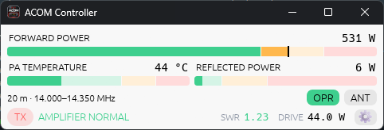

<p align="center"></p>

<h1 align="center">ACOM Controller</h1>

A modern, single-executable Windows controller for ACOM solid-state amplifiers
(600S, 700S, 500S, 1200S, 1400S, 2020S), written in Rust.

It talks to the amplifier over its RS-232 interface using the protocol described in
`doc/ACOM_RS_232_Serial_Protocol_Description_for_Solid-State_Amplifiers_GB_01_2026.pdf`.

> Status: version 1.0.0. Runs in built-in demo mode and has been exercised on an ACOM 1200S (connect, telemetry, remote power on/off). Other models are untested. See [Roadmap](#roadmap).

## Screenshots

Captured in demo mode with the simulated amplifier transmitting.

**Full layout**

| Dark | Light |
| --- | --- |
|  |  |

**Compact layout**

| Dark | Light |
| --- | --- |
|  |  |

## Getting started

1. **Get the program.** Download `acom-controller.exe` from the
   [Releases](https://github.com/danohman/acom-controller/releases) page (no installer, no runtime needed),
   or [build it yourself](#build).
2. **Try it without hardware.** Run the exe and choose *Settings ▸ Connection ▸ Demo*. A simulated amplifier
   appears; on the full layout the *Demo transmitter* card lets you key it and set the drive power.
3. **Connect your amplifier.** Connect the amplifier's RS-232 port to your PC (a USB serial adapter works),
   then in *Settings ▸ Connection* choose *Serial port*, pick the COM port and press *Apply connection*.
   The link is 9600 baud, 8N1; the amplifier is polled automatically.
4. **Optional extras** (all in *Settings*):
   - *Power & sharing* – remote power-on button (pulses DTR/RTS), and sharing the amplifier over TCP so
     another PC can use *Remote* mode.
   - *Radio* – follow your transceiver's frequency from N1MM+ (UDP), rigctld, or a shared-memory logger
     and switch the amplifier band automatically.
   - *Display* – compact layout, dark/light theme, UI scale, temperature units, peak hold.
   - *Alerts* – SWR threshold, power-off confirmation and sound alerts.

Always try a new setup into a dummy load first.

## What's new in 1.0.0

- **Settings in their own window** with sections (Connection, Power & sharing, Radio, Display, Alerts,
  System, About), so it is usable even from the slim compact window.
- **Amplifier settings** got the same treatment (Operation, CAT interface, User text, Antenna names).
- **Segmented green/amber/red meters** on every bar graph. The forward-power zones follow the connected
  model's rated power (amber from 80 %, red at rated power).
- **Compact layout** is slimmer: no top bar, the settings button sits in the status strip, and the window
  fits its content.
- **OPR/STB button** is green in operate and orange in standby; the status chip shows RX (green),
  STB (orange) or TX (red). *Inhibit TX* turns red while TX is inhibited.
- **Online time** is shown in years, months, days, hours and minutes.
- **Light theme** uses black text.
- **Update check** – a *Check for new version* button in *Settings ▸ About*, and an automatic check
  against GitHub Releases at startup (can be switched off).
- **About page** with version, copyright and license.

## Features

- **One file to ship** – a statically linked `acom-controller.exe`, no installer, no runtime.
- **Live dashboard** – forward/reflected/drive power, SWR, PA current, voltages, temperatures,
  fan speed, active LPF, with history plots and peak hold.
- **Full control** – standby/operate, TX inhibit, band selection (current band highlighted), fault clearing,
  alarm log; antenna/segment/ATU controls appear only when the amplifier has an ATU/ASEL.
- **Remote power on/off** – one header button that switches between *Power on* and *Power off*. Power-on drives
  the RS-232 DTR/RTS control lines (default DTR+RTS, 1000 ms; configurable in Settings). The app keeps
  polling while the amplifier is off and picks it up as soon as it boots.
- **Radio integration** – follow the transceiver frequency from logging software or rigctld and
  switch the amplifier band automatically.
- **Remote operation** – share the amplifier's serial port over TCP and control it from another PC.
- **Alerts** – synthesised sound alerts for warnings/faults, high SWR and link loss; optional tray icon.
- **Demo mode** – built-in amplifier simulator, so the UI can be explored without hardware.

## Build

Requires a recent stable Rust toolchain with the MSVC target. The Windows build links the C runtime
statically: set `RUSTFLAGS=-C target-feature=+crt-static` for release builds so the result is a single
self-contained exe.

```powershell
cargo test              # unit tests
cargo run               # debug build
cargo build --release   # target\release\acom-controller.exe
```

## Layout

| Path | Purpose |
| --- | --- |
| `src/protocol/` | Framing, message decoding, command builders, alarm catalogue (no I/O) |
| `src/` (other) | Config, serial/TCP link, simulator, radio integrations, update check, UI |
| `assets/` | Icon and README screenshots |
| `doc/` | Manufacturer protocol documentation |

## Safety

This software can switch an RF power amplifier between operating states. Always verify behaviour
with a dummy load first. The authors accept no responsibility for equipment damage.

## License

Copyright © 2026 Dan Muntz (WD4DAN).

This program is free software: you can redistribute it and/or modify it under the terms of the
GNU General Public License as published by the Free Software Foundation, either version 3 of the
License, or (at your option) any later version. It is distributed in the hope that it will be useful,
but WITHOUT ANY WARRANTY; without even the implied warranty of MERCHANTABILITY or FITNESS FOR A
PARTICULAR PURPOSE. See <https://www.gnu.org/licenses/gpl-3.0.html>.

## Roadmap

- [x] Protocol layer with tests
- [x] Serial link + amplifier simulator
- [x] Dashboard UI
- [x] Radio integrations (N1MM+ UDP, rigctld, shared-memory loggers) – untested with real loggers
- [x] Remote (TCP) mode – untested
- [x] Remote power on/off verified on ACOM 1200S
- [ ] Wider hardware validation (other models, ATU/ASEL, units and severity assumptions)
- [x] Exe icon (embedded), tray icon (Windows/macOS; optional close-to-tray)
- [x] Sound alerts (warnings/faults, high SWR, link lost/restored; synthesised tones)
- [x] Hard-fault viewer (reads records from the amplifier; the 1200S answers only some requests, so loading can be partial)
- [x] Amplifier settings editor (operation flags, buzzer volume, CAT interface, user text, antenna names)
- [x] Light/dark themes, compact layout, update check
